# Практическая работа №1. Классы, объекты и конструкторы

## Цель работы

В этой работе вы начнёте создавать большой учебный проект **«Гильдия героев»**, который будет развиваться на протяжении всего курса.

Сегодня необходимо:

- создать консольный проект на C#;
- подготовить Git-репозиторий;
- понять, зачем в программе нужны классы;
- создать первый класс `Hero`;
- разобраться, чем **класс** отличается от **объекта**;
- изучить поля класса;
- создать конструктор;
- создавать объекты с помощью `new`;
- создать несколько независимых героев;
- убедиться, что каждый объект хранит собственное состояние.

---

# 1. Что мы создаём

Начнём программу для управления гильдией героев. У каждого героя есть имя, здоровье, уровень и опыт.

Пока эти данные можно хранить в отдельных переменных:

```csharp
string hero1Name = "Ярослав";
int hero1Health = 100;
int hero1Level = 1;
int hero1Experience = 0;

string hero2Name = "Анастасия";
int hero2Health = 90;
int hero2Level = 1;
int hero2Experience = 0;
```

С ростом числа героев таких переменных становится слишком много. Данные одного героя нужно хранить вместе — для этого используем **класс**.

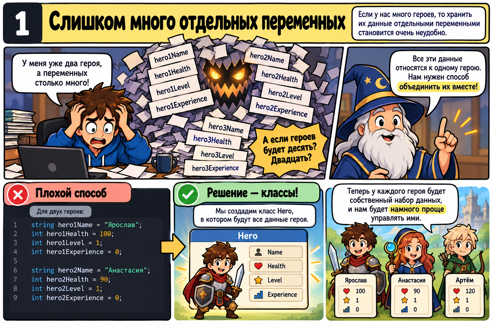

---

# 2. Класс и объект

**Класс** описывает структуру объектов. **Объект** — конкретный экземпляр класса.

Например, `Hero` описывает героя, а Ярослав, Анастасия и Артём — отдельные объекты этого класса.

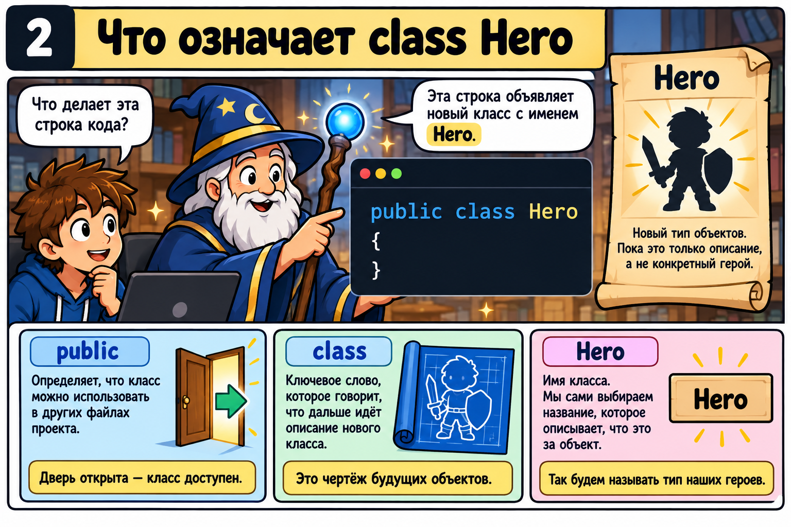

---

# 3. Создание проекта

Откройте **Git Bash**.

Перейдите в папку `Documents`:

```bash
cd Documents
```

Создайте новый консольный проект.

Вместо `ФИО` укажите свою фамилию латинскими буквами:

```bash
dotnet new console -n GuildOfHeroes_ФИО
```

Перейдите в созданную папку:

```bash
cd GuildOfHeroes_ФИО
```

Создайте `.gitignore`:

```bash
dotnet new gitignore
```

Инициализируйте Git:

```bash
git init -b main
```

Создайте файл `README.md`:

```bash
touch README.md
```

Откройте проект в Visual Studio Code:

```bash
code .
```

---

# 4. Подготовка README

Откройте файл:

```text
README.md
```

Добавьте:

```md
# GuildOfHeroes

Автор: ФИО  
Дата выполнения: ДД.ММ.ГГГГ
```

Укажите свои данные.

---

# 5. Проверка проекта

Откройте **терминал Visual Studio Code**.

Для этого можно использовать:

```text
Terminal → New Terminal
```

Или нажать `Ctrl+J`.

Убедитесь, что терминал открыт именно в корневой папке проекта.

В этой папке должен находиться файл:

```text
GuildOfHeroes_ФИО.csproj
```

Например, приглашение терминала может выглядеть примерно так:

```text
~/Documents/GuildOfHeroes_Ivanov
```

В терминале Visual Studio Code выполните:

```bash
dotnet run
```

Если проект создан правильно, вы увидите стандартное сообщение:

```text
Hello, World!
```

Это означает, что проект компилируется и запускается.

---

# 6. Первый коммит

Сохраните начальное состояние проекта:

```bash
git add .
git commit -m "Initial project"
```

---

# 7. Подключение GitHub

На GitHub создайте новый **public**-репозиторий:

```text
GuildOfHeroes
```

Не добавляйте через сайт:

- README;
- `.gitignore`;
- License.

Репозиторий должен быть пустым.

Скопируйте HTTPS-адрес репозитория.

Он будет выглядеть примерно так:

```text
https://github.com/USERNAME/GuildOfHeroes.git
```

В терминале выполните:

```bash
git remote add origin https://github.com/USERNAME/GuildOfHeroes.git
```

Замените `USERNAME` на свой логин GitHub.

Отправьте проект:

```bash
git push -u origin main
```

---

# 8. Создаём первый класс

Сейчас наша программа состоит практически только из файла:

```text
Program.cs
```

Но герой — это отдельная сущность нашей программы.

Поэтому описание героя не будем размещать внутри `Program.cs`.

Создайте в корне проекта новый файл:

```text
Hero.cs
```

Можно выполнить в терминале команду:

```bash
touch Hero.cs
```

Создайте `.editorconfig` в корне с файлами проекта:

```bash
touch .editorconfig
```

Добавьте внутрь файла `.editorconfig` правила (все скобки на той же строке):

```csharp
[*.cs]
csharp_new_line_before_open_brace = none
```

Структура проекта пока будет выглядеть так:

```text
GuildOfHeroes_ФИО/
│
├── Hero.cs
├── Program.cs
├── README.md
├── GuildOfHeroes_ФИО.csproj
├── .editorconfig
└── .gitignore
```

---

# 9. Минимальный класс

Откройте `Hero.cs` и добавьте:

```csharp
public class Hero {
}
```

Имя нового типа:

```csharp
Hero
```

Объявление класса:

```csharp
class Hero
```

Ключевое слово для объявления класса:

```csharp
class
```

Доступность из других частей программы задаёт:

```csharp
public
```

Подробнее доступ рассмотрим в следующих работах.

---

# 10. Добавляем состояние героя

Добавим поля для имени, здоровья, уровня и опыта. Замените содержимое `Hero.cs`:

```csharp
public class Hero {
    public string Name;
    public int Health;
    public int Level;
    public int Experience;
}
```

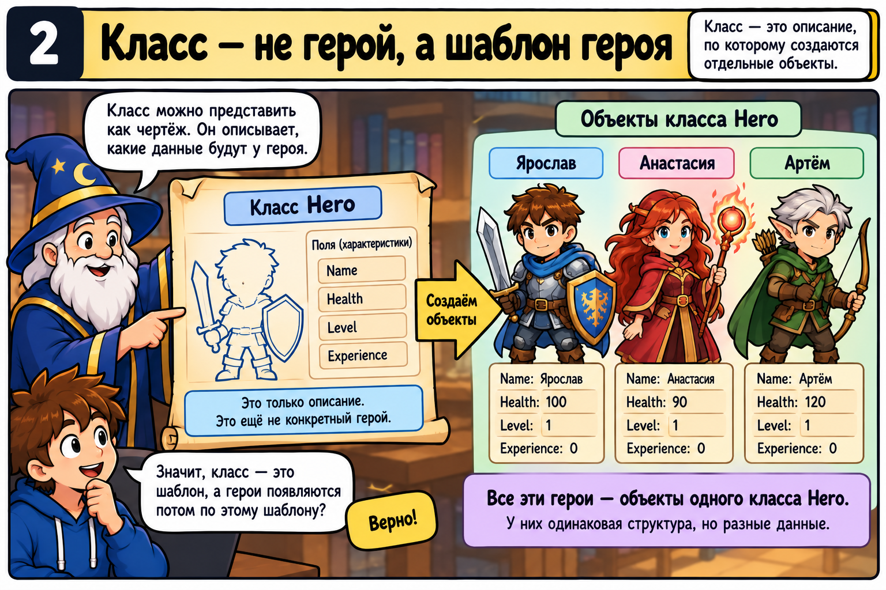

---

# 11. Что такое поле

**Поле** — данные, которые принадлежат объекту и описывают его состояние. Например, поле имени:

```csharp
public string Name;
```

Наши четыре поля:

```csharp
Name
Health
Level
Experience
```

Пример состояния одного героя:

```text
Name       = Ярослав
Health     = 100
Level      = 1
Experience = 0
```

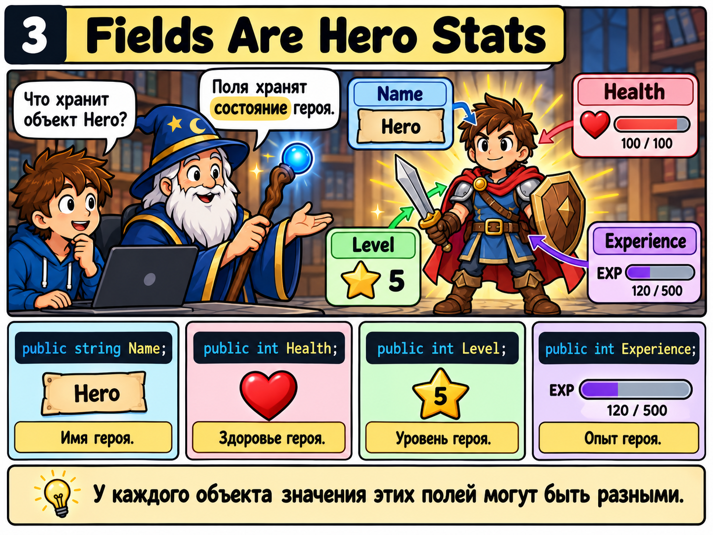

---

# 12. Создание первого объекта

Откройте `Program.cs`. Удалите стандартный код:

```csharp
Console.WriteLine("Hello, World!");
```

Напишите:

```csharp
Hero yaroslav = new Hero();
```

Слева указаны тип `Hero` и переменная `yaroslav`:

```csharp
Hero yaroslav
```

Справа создаётся объект:

```csharp
new Hero()
```

За создание отвечает:

```csharp
new
```

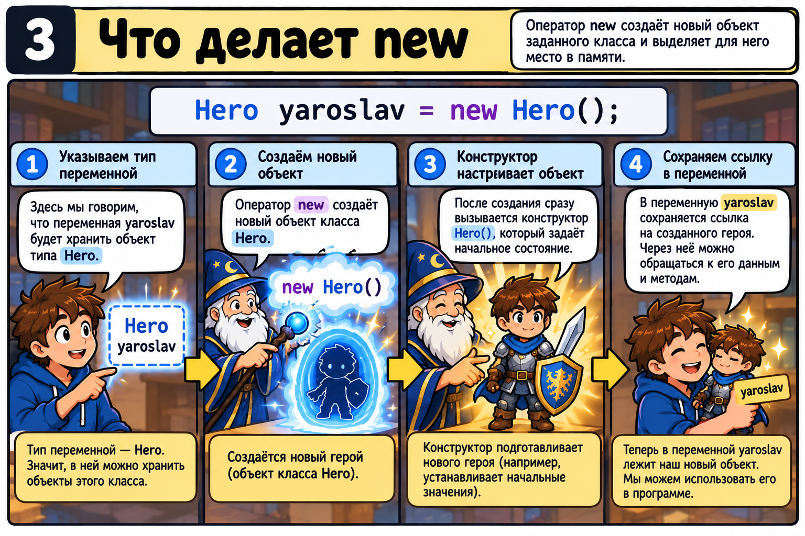

Полная строка уже есть в файле, повторно добавлять её не нужно:

```csharp
Hero yaroslav = new Hero();
```

Создаётся новый объект `Hero`, а переменная `yaroslav` используется для работы с ним.

---

# 13. Заполняем поля объекта

Дополните существующий код в `Program.cs`, чтобы он выглядел так:

```csharp
Hero yaroslav = new Hero();

yaroslav.Name = "Ярослав";
yaroslav.Health = 100;
yaroslav.Level = 1;
yaroslav.Experience = 0;
```

Через точку обращаемся к члену конкретного объекта:

```csharp
yaroslav.Name
```

Например, обращение к полю `Name` объекта `yaroslav`:

```csharp
yaroslav.Name
```

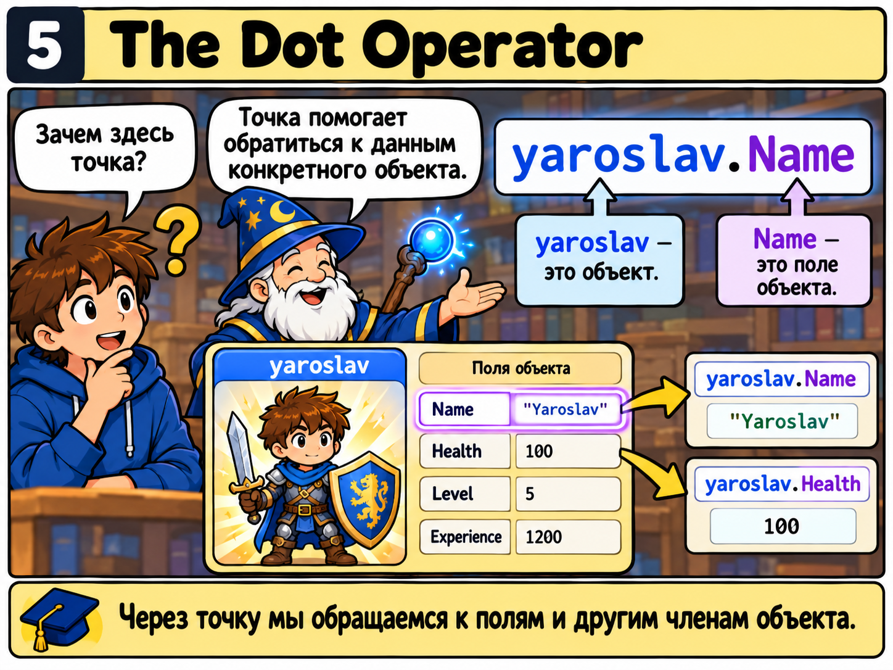

Другой пример обращения к полю:

```csharp
yaroslav.Health
```

---

# 14. Выводим героя

Добавьте далее в `Program.cs`:

```csharp
Console.WriteLine(">>> Герой <<<");
Console.WriteLine($"Имя: {yaroslav.Name}");
Console.WriteLine($"Здоровье: {yaroslav.Health}");
Console.WriteLine($"Уровень: {yaroslav.Level}");
Console.WriteLine($"Опыт: {yaroslav.Experience}");
```

Полный код `Program.cs` на данном этапе:

```csharp
Hero yaroslav = new Hero();

yaroslav.Name = "Ярослав";
yaroslav.Health = 100;
yaroslav.Level = 1;
yaroslav.Experience = 0;

Console.WriteLine(">>> Герой <<<");
Console.WriteLine($"Имя: {yaroslav.Name}");
Console.WriteLine($"Здоровье: {yaroslav.Health}");
Console.WriteLine($"Уровень: {yaroslav.Level}");
Console.WriteLine($"Опыт: {yaroslav.Experience}");
```

Запустите в терминале:

```bash
dotnet run
```

Пример результата:

```text
>>> Герой <<<
Имя: Ярослав
Здоровье: 100
Уровень: 1
Опыт: 0
```

---

# 15. Проблема текущего варианта

После создания героя приходится вручную заполнять поля:

```csharp
Hero yaroslav = new Hero();

yaroslav.Name = "Ярослав";
yaroslav.Health = 100;
yaroslav.Level = 1;
yaroslav.Experience = 0;
```

Но объект можно создать и забыть заполнить необходимые данные:

```csharp
Hero hero = new Hero();
```

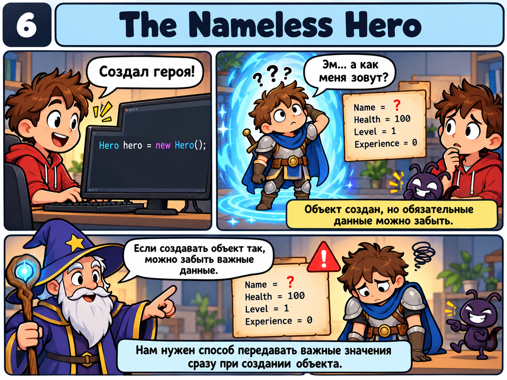

Будем передавать начальные значения при создании:

```csharp
Hero yaroslav = new Hero("Ярослав", 100);
```

Для этого добавим **конструктор**. Пока это пример будущего вызова.

---

# 16. Что такое конструктор

**Конструктор** выполняется при создании объекта и задаёт его начальное состояние. Пример:

```csharp
public class Person {
    public string Name;

    public Person(string name) {
        Name = name;
    }
}
```

Создание объекта с именем:

```csharp
Person person = new Person("Антон");
```

Имя передаётся через параметр:

```csharp
string name
```

и сохраняется в поле:

```csharp
Name = name;
```

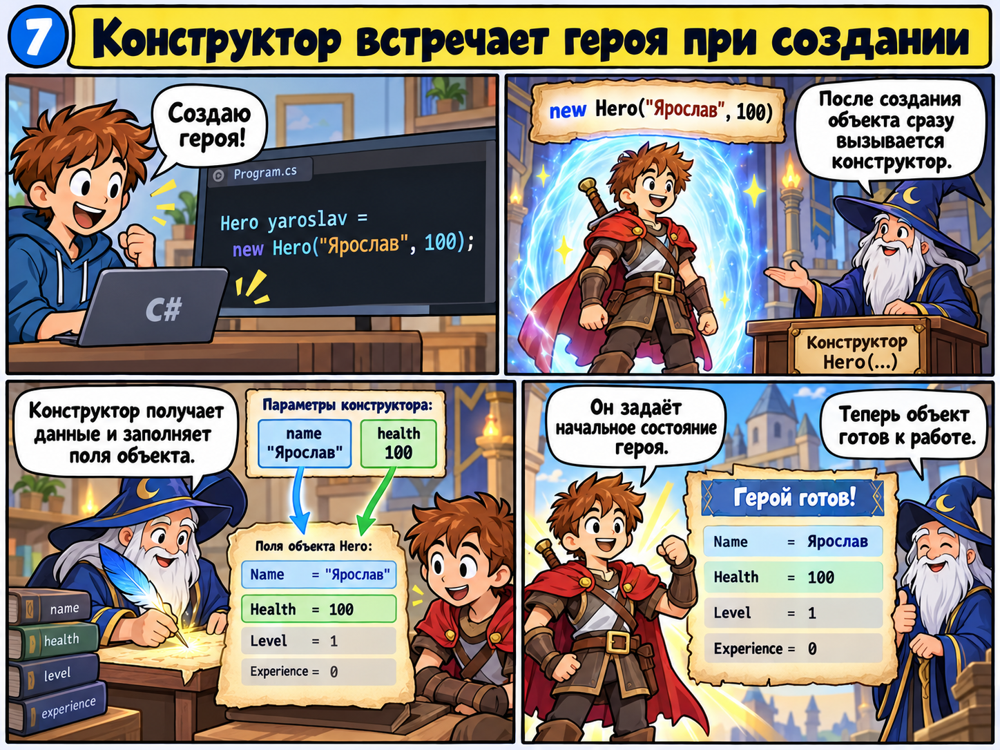

Пример `Person` добавлять в проект не нужно. Далее создадим конструктор для `Hero`.

---

# 17. Добавляем конструктор Hero

Откройте `Hero.cs`. Сохраните поля и добавьте после них, внутри класса, конструктор:

```csharp
public class Hero
{
    // тут ваши поля

    public Hero(string name, int health) {
        Name = name;
        Health = health;
        Level = 1;
        Experience = 0;
    }
}
```

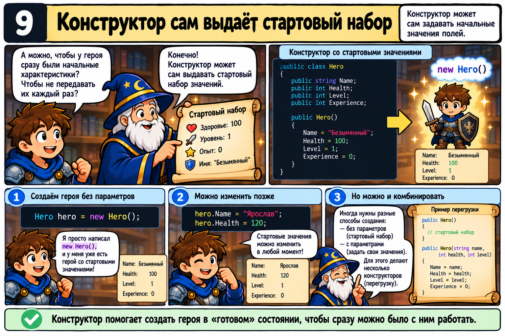

Заголовок конструктора:

```csharp
public Hero(string name, int health)
```

Его имя совпадает с именем класса — `Hero`. Типа возвращаемого значения у конструктора нет, поэтому неверны записи:

```csharp
void Hero(...)
```

```csharp
string Hero(...)
```

Правильная форма:

```csharp
public Hero(...)
```

---

# 18. Параметры конструктора

Конструктор принимает параметры `name` и `health`:

```csharp
string name
```

```csharp
int health
```

Полученные значения сохраняются в поля:

```csharp
Name = name;
Health = health;
```

Уровень и опыт класс задаёт автоматически:

```csharp
Level = 1;
Experience = 0;
```

Поэтому передавать все четыре значения не нужно. Такой вызов не соответствует нашему конструктору:

```csharp
new Hero("Ярослав", 100, 1, 0);
```


---

# 19. Изменяем создание объекта

Теперь старый код:

```csharp
Hero yaroslav = new Hero();

yaroslav.Name = "Ярослав";
yaroslav.Health = 100;
yaroslav.Level = 1;
yaroslav.Experience = 0;
```

больше не нужен.

Откройте файл `Program.cs` и полностью замените его следующим вариантом:

```csharp
Hero yaroslav = new Hero("Ярослав", 100);

Console.WriteLine(">>> Герой <<<");
Console.WriteLine($"Имя: {yaroslav.Name}");
Console.WriteLine($"Здоровье: {yaroslav.Health}");
Console.WriteLine($"Уровень: {yaroslav.Level}");
Console.WriteLine($"Опыт: {yaroslav.Experience}");
```

Запустите в терминале:

```bash
dotnet run
```

Результат должен остаться тем же:

```text
>>> Герой <<<
Имя: Ярослав
Здоровье: 100
Уровень: 1
Опыт: 0
```

Мы изменили устройство программы, но её результат остался правильным.

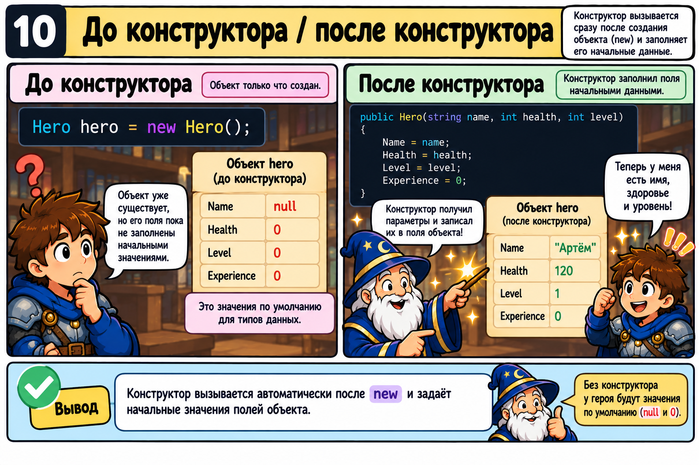

---

# 20. Создаём несколько объектов

Один класс позволяет создавать множество объектов:

```csharp
Hero
```

Замените содержимое `Program.cs` кодом создания и вывода трёх героев:

```csharp
Hero yaroslav = new Hero("Ярослав", 100);
Hero anastasia = new Hero("Анастасия", 90);
Hero artem = new Hero("Артём", 120);

Console.WriteLine(">>> Герой 1 <<<");
Console.WriteLine($"Имя: {yaroslav.Name}");
Console.WriteLine($"Здоровье: {yaroslav.Health}");
Console.WriteLine($"Уровень: {yaroslav.Level}");
Console.WriteLine($"Опыт: {yaroslav.Experience}");

Console.WriteLine();

Console.WriteLine(">>> Герой 2 <<<");
Console.WriteLine($"Имя: {anastasia.Name}");
Console.WriteLine($"Здоровье: {anastasia.Health}");
Console.WriteLine($"Уровень: {anastasia.Level}");
Console.WriteLine($"Опыт: {anastasia.Experience}");

Console.WriteLine();

Console.WriteLine(">>> Герой 3 <<<");
Console.WriteLine($"Имя: {artem.Name}");
Console.WriteLine($"Здоровье: {artem.Health}");
Console.WriteLine($"Уровень: {artem.Level}");
Console.WriteLine($"Опыт: {artem.Experience}");
```

Запустите программу:

```bash
dotnet run
```

Ожидаемый результат:

```text
>>> Герой 1 <<<
Имя: Ярослав
Здоровье: 100
Уровень: 1
Опыт: 0

>>> Герой 2 <<<
Имя: Анастасия
Здоровье: 90
Уровень: 1
Опыт: 0

>>> Герой 3 <<<
Имя: Артём
Здоровье: 120
Уровень: 1
Опыт: 0
```

---

# 21. Один класс — разные объекты

Сравните строки создания героев:

```csharp
Hero yaroslav = new Hero("Ярослав", 100);
Hero anastasia = new Hero("Анастасия", 90);
Hero artem = new Hero("Артём", 120);
```

У всех объектов одна структура `Hero`, но собственные значения полей. Проверим их независимость на следующем шаге.

---

# 22. Проверяем независимость объектов

В `Program.cs` после создания трёх героев, перед выводом информации, добавьте:

```csharp
yaroslav.Health = 75;
```

Начало файла должно выглядеть так:

```csharp
Hero yaroslav = new Hero("Ярослав", 100);
Hero anastasia = new Hero("Анастасия", 90);
Hero artem = new Hero("Артём", 120);

yaroslav.Health = 75;
```

Запустите программу. Проверьте здоровье всех трёх героев: Ярослав — `75`, Анастасия — `90`, Артём — `120`.

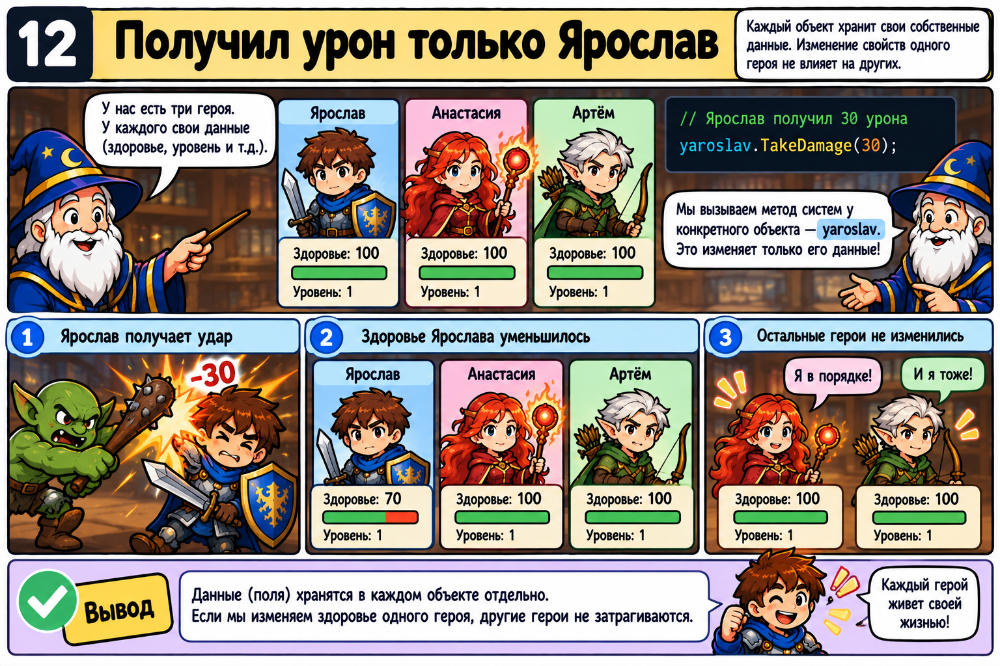

Изменение состояния одного объекта не изменяет остальные объекты этого класса.

---

# 23. Но появилась новая проблема

Внешний код может записать в поле не только допустимое значение:

```csharp
yaroslav.Health = 75;
```

но и отрицательное:

```csharp
yaroslav.Health = -500;
```

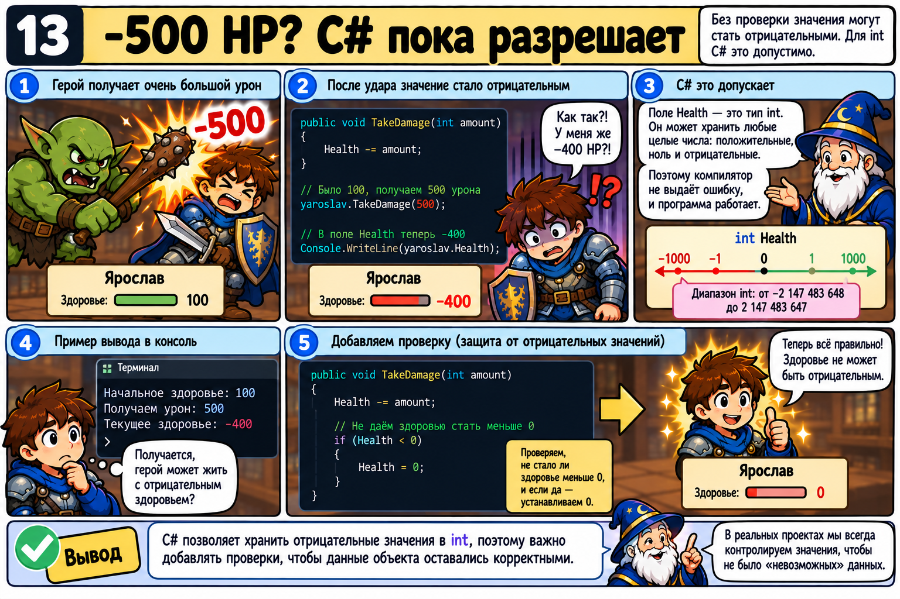

Пока `Hero` только хранит данные и не защищает своё состояние. Даже урон вычисляется снаружи:

```csharp
yaroslav.Health -= 20;
```

В следующей работе добавим **поведение**: вместо прямого изменения поля

```csharp
yaroslav.Health -= 20;
```

будем поручать герою получить урон. Сейчас эти примеры добавлять не нужно: оставьте в программе изменение здоровья на `75` для проверки независимости объектов.

---

# 24. Итоговый Hero.cs

Проверьте файл:

```text
Hero.cs
```

Он должен выглядеть так:

```csharp
public class Hero {
    public string Name;
    public int Health;
    public int Level;
    public int Experience;

    public Hero(string name, int health) {
        Name = name;
        Health = health;
        Level = 1;
        Experience = 0;
    }
}
```

---

# 25. Итоговый Program.cs

Проверьте:

```text
Program.cs
```

```csharp
Hero yaroslav = new Hero("Ярослав", 100);
Hero anastasia = new Hero("Анастасия", 90);
Hero artem = new Hero("Артём", 120);

yaroslav.Health = 75;

Console.WriteLine(">>> Герой 1 <<<");
Console.WriteLine($"Имя: {yaroslav.Name}");
Console.WriteLine($"Здоровье: {yaroslav.Health}");
Console.WriteLine($"Уровень: {yaroslav.Level}");
Console.WriteLine($"Опыт: {yaroslav.Experience}");

Console.WriteLine();

Console.WriteLine(">>> Герой 2 <<<");
Console.WriteLine($"Имя: {anastasia.Name}");
Console.WriteLine($"Здоровье: {anastasia.Health}");
Console.WriteLine($"Уровень: {anastasia.Level}");
Console.WriteLine($"Опыт: {anastasia.Experience}");

Console.WriteLine();

Console.WriteLine(">>> Герой 3 <<<");
Console.WriteLine($"Имя: {artem.Name}");
Console.WriteLine($"Здоровье: {artem.Health}");
Console.WriteLine($"Уровень: {artem.Level}");
Console.WriteLine($"Опыт: {artem.Experience}");
```

---

# 26. Итоговая структура проекта

К концу работы проект должен выглядеть примерно так:

```text
GuildOfHeroes_ФИО/
│
├── Hero.cs
├── Program.cs
├── README.md
├── GuildOfHeroes_ФИО.csproj
├── .editorconfig
├── .gitignore
├── bin/
└── obj/
```

Папки:

```text
bin
obj
```

создаются автоматически .NET.

Добавлять их в Git не нужно — они исключаются через `.gitignore`.

---

# 27. Что нужно понимать после работы

Проверьте понятия по знакомым примерам.

### Класс

Описывает структуру объектов:

```csharp
public class Hero
```

### Объект

Конкретный экземпляр класса:

```csharp
Hero yaroslav = new Hero("Ярослав", 100);
```

### Поле

Часть состояния объекта:

```csharp
public int Health;
```

### `new`

Создаёт новый объект:

```csharp
new Hero("Ярослав", 100)
```

### Конструктор

Задаёт начальное состояние объекта:

```csharp
public Hero(string name, int health) {
    Name = name;
    Health = health;
    Level = 1;
    Experience = 0;
}
```

### Один класс и несколько объектов

Объекты имеют одинаковую структуру, но собственные значения:

```csharp
Hero yaroslav = new Hero("Ярослав", 100);
Hero anastasia = new Hero("Анастасия", 90);
Hero artem = new Hero("Артём", 120);
```

---

# 28. Частые ошибки

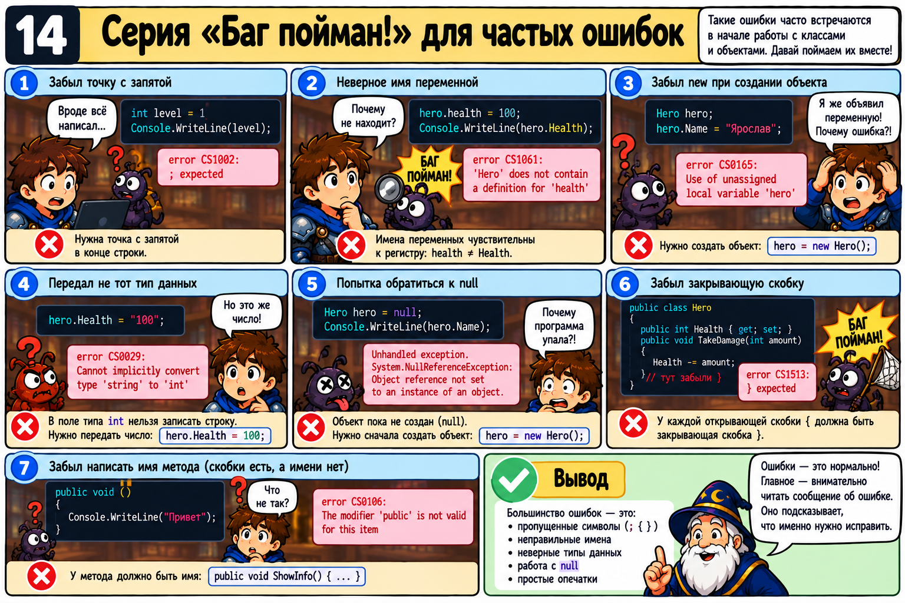

## Ошибка 1. Забыли `new`

Неправильно:

```csharp
Hero yaroslav = Hero("Ярослав", 100);
```

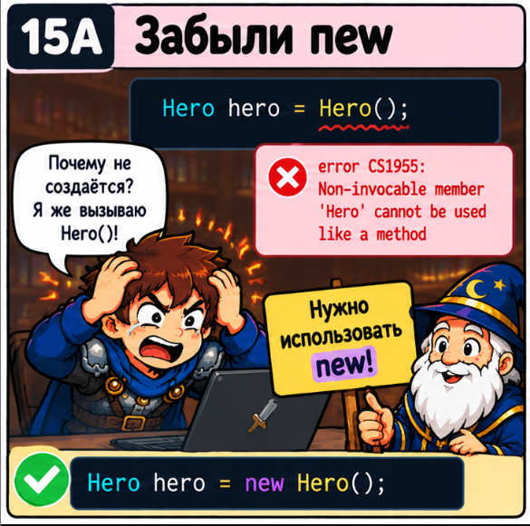

Правильно:

```csharp
Hero yaroslav = new Hero("Ярослав", 100);
```

---

## Ошибка 2. Пытаемся вызвать старый конструктор

После того как мы создали:

```csharp
public Hero(string name, int health)
```

следующая строка уже неправильная:

```csharp
Hero hero = new Hero();
```

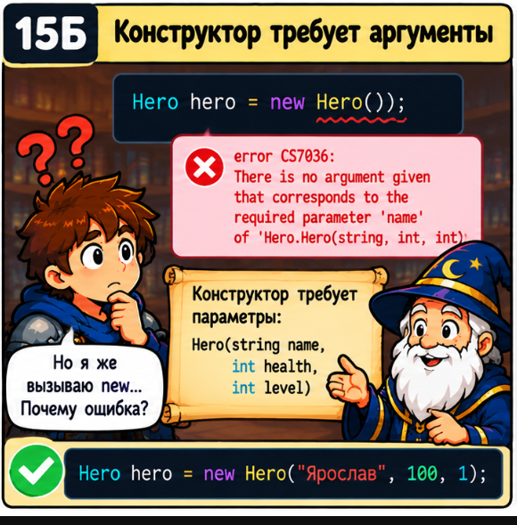

Наш конструктор требует два аргумента.

Правильно:

```csharp
Hero hero = new Hero("Иван", 100);
```

---

## Ошибка 3. Аргументы переданы не тех типов

Неправильно:

```csharp
Hero hero = new Hero(100, "Иван");
```

Конструктор ожидает:

```csharp
Hero(string name, int health)
```

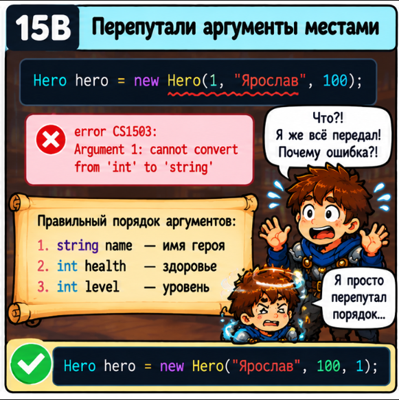

Поэтому первым должно идти имя, а вторым — здоровье:

```csharp
Hero hero = new Hero("Иван", 100);
```

---

## Ошибка 4. Hero.cs находится не в проекте

Убедитесь, что файл:

```text
Hero.cs
```

создан внутри папки проекта:

```text
GuildOfHeroes_ФИО
```

а не рядом с ней.

---

## Ошибка 5. Названия отличаются регистром

C# различает:

```csharp
Hero
```

и:

```csharp
hero
```

То же относится к:

```csharp
Health
```

и:

```csharp
health
```

---

# 29. Проверка программы

Перед сохранением результата выполните:

```bash
dotnet run
```

Программа должна:

1. успешно компилироваться;
2. создать минимум трёх героев;
3. показать имя каждого героя;
4. показать здоровье каждого героя;
5. показать уровень;
6. показать опыт;
7. продемонстрировать, что изменение одного объекта не изменяет остальные.

---

# 30. Git

Проверьте состояние репозитория:

```bash
git status
```

Добавьте изменения:

```bash
git add .
```

Создайте коммит:

```bash
git commit -m "Added Hero class and constructors"
```

Отправьте изменения:

```bash
git push
```

---

# 31. Самостоятельная работа: собственный проект

Кроме проекта **«Гильдия героев»**, на протяжении курса вы будете постепенно создавать собственное небольшое приложение.

Выберите одну предметную область.

Например:

```text
каталог игр
библиотека
магазин
компьютерная техника
инвентарь
коллекция фильмов
музыкальная коллекция
персонажи игры
```

Можно предложить собственную тему.

---

## Задание 1. Определите главную сущность

Не копируйте класс `Hero` с заменой названий.

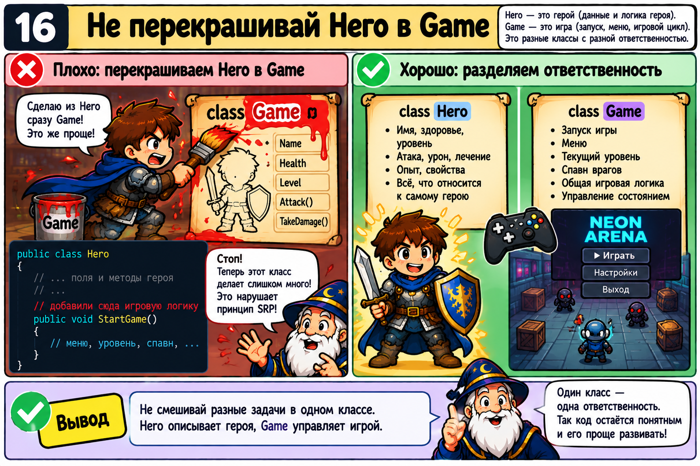

Сначала ответьте на вопрос:

> Какой объект является одним из основных объектов моей программы?

Например, для библиотеки это может быть не просто «что-то с названием», а:

```text
Book
```

Для учёта компьютерной техники:

```text
Computer
```

Для каталога игр:

```text
Game
```

Для магазина:

```text
Product
```

---

## Задание 2. Определите состояние объекта

Выберите минимум четыре характеристики, которые действительно описывают ваш объект.

Например, для игры можно хранить:

```text
название
жанр
год выхода
рейтинг
```

Но вы должны самостоятельно решить, какие данные нужны именно вашей предметной области.

Не добавляйте поля только ради количества.

---

## Задание 3. Создайте класс

Создайте отдельный `.cs`-файл.

Например:

```text
Game.cs
```

Внутри создайте собственный класс.

Класс должен содержать:

- минимум четыре поля;
- минимум два разных типа данных;
- конструктор;
- параметры конструктора;
- разумные начальные значения там, где они подходят.

---

## Задание 4. Создайте объекты

В `Program.cs` создайте минимум три разных объекта своего класса.

Например:

```text
объект №1
объект №2
объект №3
```

У объектов должны отличаться данные.

---

## Задание 5. Выведите состояние объектов

Выведите в консоль информацию обо всех созданных объектах.

По результату программы должно быть понятно, что каждый объект хранит собственные значения.

---

## Задание 6. Ответьте на вопросы

Добавьте в конец `README.md` раздел:

```md
## Собственный проект

Тема проекта: ...

Главный класс: ...

Почему этот объект нужен программе:
...

Какие данные хранит объект:

- ...
- ...
- ...
- ...

Какие значения задаются через конструктор:
...

Какие значения можно задавать автоматически:
...
```

Ответы должны соответствовать именно вашему проекту.

---

# 32. Дополнительное задание

Это задание для шустрых студентов.

Посмотрите на созданный вами класс собственного проекта.

Выберите одно новое поле, для которого существует логичное начальное значение.

Например, некоторый объект при создании может иметь:

```text
рейтинг = 0
```

или:

```text
количество использований = 0
```

или:

```text
доступен = true
```

Добавьте такое поле так, чтобы его не приходилось передавать при каждом создании объекта.

Например, вместо:

```csharp
new SomeObject(..., 0)
```

начальное значение должно назначаться внутри конструктора.

После этого создайте новый объект и убедитесь, что начальное значение устанавливается правильно.

В `README.md` кратко объясните:

```text
Какое значение я решил задавать автоматически и почему?
```

---

# 33. Результат работы

После выполнения практической работы у вас должен быть:

- создан проект `GuildOfHeroes_ФИО`;
- настроен Git;
- подключён GitHub;
- создан класс `Hero`;
- добавлены поля героя;
- создан конструктор;
- создано несколько объектов `Hero`;
- продемонстрировано независимое состояние объектов;
- выполнен собственный небольшой ООП-проект;
- изменения сохранены в GitHub.

Как связаны изученные понятия?

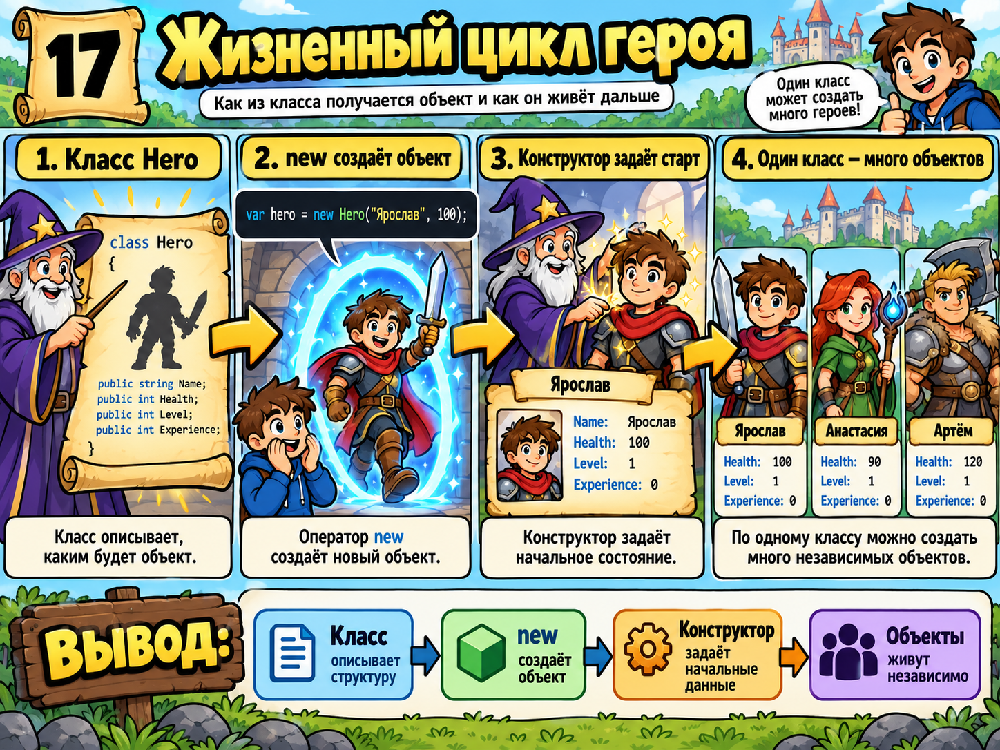

Класс описывает структуру объектов, `new` создаёт объект, конструктор задаёт его начальное состояние, а каждый объект хранит собственные данные.

Сейчас `Hero` умеет хранить состояние, но почти не умеет управлять им самостоятельно.

Следующий шаг развития проекта — перенести действия с героем внутрь самого объекта.
